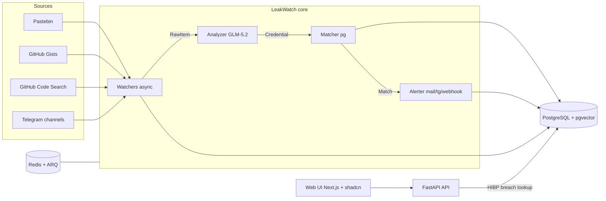

# LeakWatch — Credential Leak Monitor

LeakWatch monitors paste sites, Telegram channels and public leak dumps for
your domains and email addresses, and alerts you the moment a credential
matching your monitored values shows up.

> **Status:** Active prototype — monitoring pipeline, persistence, API,
> password-breach check and Next.js interface are implemented. Some data
> sources require separate API subscriptions or access tokens.

## Why?

Every organisation with more than a handful of employees eventually faces
credential leaks in public paste archives and chat channels. LeakWatch is a
small, focused tool that watches those sources for you and raises an alert.

## Architecture



### Core loop

```
Watcher polls source -> new text found?
  -> GLM-5.2 extracts emails, passwords, URLs, wallets
  -> Matcher checks against user domains/emails
  -> Match? -> Alert + persist
```

## Tech stack

| Layer        | Tech                          | Why                                    |
| ------------ | ----------------------------- | --------------------------------------- |
| Language     | Python 3.12+                  | #1 in security tooling                  |
| Async        | asyncio + httpx               | Modern Python patterns                  |
| Queue        | Redis + ARQ                   | Lighter than Celery, modern             |
| Database     | PostgreSQL + pgvector         | SQL + vector search                     |
| LLM          | GLM-5.2 via OpenRouter         | AI integration                          |
| Frontend     | Next.js + shadcn/ui           | React, professional look                 |
| Deployment   | Docker Compose + GitHub Actions CI | DevOps basics                    |
| Tests        | pytest + coverage >80%        | Engineering discipline                  |

## Quickstart

```bash
git clone https://github.com/LutzHoffmann/LeakWatch.git leakwatch
cd leakwatch
cp backend/.env.example backend/.env   # fill in LLM_API_KEY etc.
docker compose up --build
```

The stack starts PostgreSQL (pgvector), Redis, the backend ARQ worker and the
Next.js frontend stub.

### Local development (backend)

```bash
cd backend
uv sync --extra dev
uv run leakwatch init-db                       # create tables + seed default domains
uv run pytest                                  # run tests with coverage gate
uv run leakwatch run-once                      # run a single watch cycle
uv run leakwatch serve                         # start the FastAPI API server (port 8000)
uv run arq leakwatch.worker.WorkerSettings     # start the cron worker
```

The worker persists every cycle: `RawItem` (deduped by `source`+`external_id`)
-> `Credential` (LLM extraction) -> `Match` (against `user_domains`) ->
`Alert` (per sent notification).

### Watchers

| Source | Watcher | Notes |
| --- | --- | --- |
| Pastebin | `PastebinWatcher` | Scrapes `pastebin.com/archive`, fetches raw paste bodies |
| GitHub Gists | `GitHubGistWatcher` | Polls the public gists feed |
| GitHub Code Search | `GitHubCodeSearchWatcher` | Searches public code for leaked credentials (needs `GITHUB_TOKEN`) |

### API server (frontend)

`uv run leakwatch serve` starts a FastAPI app exposing:

- `GET /api/intelx/search?selector=<email|domain|ip>` — selector search via
  Intelligence X (leaks, pastes, darknet sources), used by the Next.js frontend
  at `/check`. Requires an `INTELX_API_KEY` (paid IntelX subscription).
- `POST /api/pwned/check` — free, keyless password breach check via the
  Pwned Passwords k-anonymity API. Works out of the box without any key.
- `GET /api/matches` — recent credential matches found by the watch
  pipeline, including email+password pairs grouped via a shared `pair_id`.

### Local development (frontend)

```bash
cd frontend
npm install
npm run dev
```

## Configuration

All configuration is via environment variables (see
[`backend/.env.example`](backend/.env.example)). The most important ones:

| Variable                          | Purpose                              |
| --------------------------------- | ------------------------------------ |
| `DATABASE_URL`                    | Async SQLAlchemy Postgres URL        |
| `REDIS_URL`                       | Redis URL for ARQ                    |
| `LLM_API_KEY`                     | LLM provider key (OpenRouter or ZAI)  |
| `LLM_BASE_URL`                    | Provider base URL (OpenRouter or ZAI)  |
| `LLM_MODEL`                       | Model slug (default `z-ai/glm-5.2`; `glm-5.2` for ZAI direct) |
| `GITHUB_TOKEN`                    | GitHub token for the Gists + Code Search watchers   |
| `GITHUB_CODE_SEARCH_QUERIES`      | Comma-separated Code Search queries (e.g. `password,api_key`) |
| `HIBP_API_KEY`                    | HaveIBeenPwned key for the frontend breach check     |
| `INTELX_API_KEY`                 | Intelligence X key for the frontend leak search     |
| `PWNED_BASE_URL`                 | Pwned Passwords API base (free, no key)             |
| `API_CORS_ORIGINS`                | Allowed CORS origins for the FastAPI server          |
| `RESEND_API_KEY` / `ALERT_TO_EMAIL` | Email alerts (Resend)              |
| `TELEGRAM_BOT_TOKEN` / `TELEGRAM_CHAT_ID` | Telegram alerts            |
| `ALERT_WEBHOOK_URL`               | Generic webhook (Slack/Teams ready)  |

## Roadmap

- **Phase 1 (4 weeks):** Core engine — watchers, GLM-5.2 analyzer, persistence.
- **Phase 2 (2-3 weeks):** Matching + alerting against user domains/emails.
- **Phase 3 (2-3 weeks):** Web UI — overview, search, settings, analytics, OAuth.

## Project layout

```
LeakWatch/
├── .github/workflows/ci.yml
├── docker-compose.yml
├── backend/        # Python (uv) core engine + ARQ worker
│   ├── pyproject.toml
│   ├── src/leakwatch/
│   └── tests/
└── frontend/       # Next.js + shadcn/ui dashboard
```

## Contributing

PRs welcome. Please open an issue first for larger changes. Run
`uv run ruff check` and `uv run pytest` before submitting.

## License

MIT
